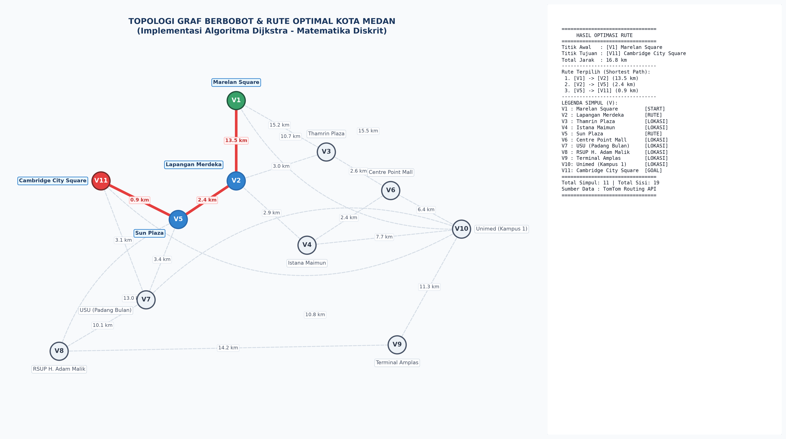
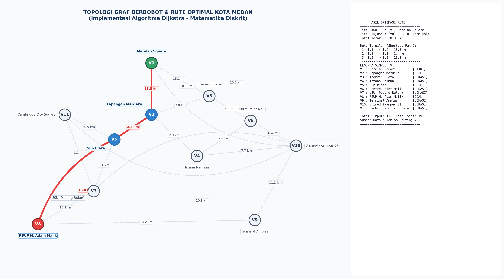
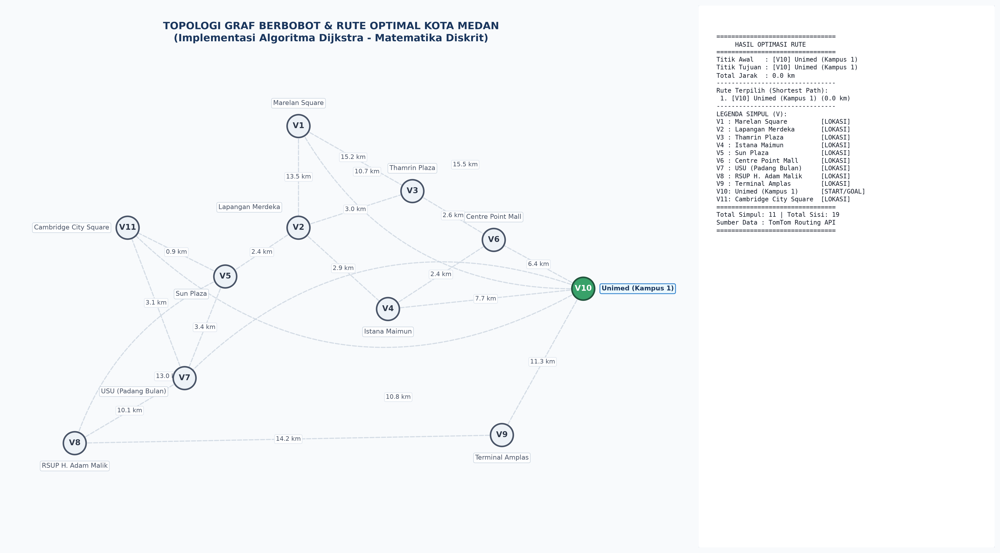

# Smart Route Optimization (Shortest Path - Dijkstra)

Proyek Kelompok Matematika Diskrit (3KOM40106)  
Program Studi Ilmu Komputer  
Dosen Pengampu: **Nurul Maulida Surbakti, M.Si.**

---

## 📌 Deskripsi Proyek
Program ini mengimplementasikan konsep **Teori Graf Berbobot** dan **Algoritma Dijkstra** untuk mencari rute perjalanan terpendek antar lokasi strategis di **Kota Medan** (11 simpul lokasi, 19 ruas jalan penghubung dengan bobot jarak riil dari TomTom Routing API).

---

## 📂 Struktur Berkas
- `main.py`: Program antarmuka Command Line Interface (CLI) interaktif untuk memilih titik awal & tujuan, melihat rute optimal, log iterasi matematis, dan membangkitkan visualisasi grafik rute.
- `dijkstra.py`: Modul inti algoritma Dijkstra menggunakan *Priority Queue (Min-Heap)*, relaksasi sisi, dan pencatatan *predecessor*.
- `graph_data.py`: Dataset graf Kota Medan ($V1 - V11$, 19 sisi) dalam bentuk *Adjacency List*.
- `test_runner.py`: Skrip pengujian otomatis untuk memverifikasi 3 *Test Case* resmi (hasil validasi peran A2).
- `requirements.txt`: Daftar pustaka Python pendukung (NetworkX & Matplotlib).
- `assets/`: Direktori penyimpanan tangkapan layar hasil visualisasi pengujian program.

---

## 🚀 Cara Menjalankan Program

### 1. Prasyarat
Pastikan Python 3.8+ sudah terpasang di komputer Anda.

### 2. Instalasi Library (Untuk Visualisasi Graf Gambar)
```bash
pip install -r requirements.txt
```

### 3. Menjalankan Program Interaktif (Demo)
```bash
python3 main.py
```
**Contoh Input Interaktif (Test Case 1):**
- Masukkan Titik Awal: `V1` (Marelan Square)
- Masukkan Titik Tujuan: `V11` (Cambridge City Square)
- Program akan langsung menampilkan:
  1. Rute rute terpilih: `[V1] Marelan Square ➔ [V2] Lapangan Merdeka ➔ [V5] Sun Plaza ➔ [V11] Cambridge City Square`
  2. Rincian jarak tiap ruas jalan
  3. Total jarak: `16.8 km`
  4. Pilihan menampilkan tabel log iterasi matematis
  5. Pilihan menyimpan gambar visual grafik rute

### 4. Menjalankan Pengujian Otomatis (3 Test Cases)
```bash
python3 test_runner.py
```

---

## 📊 Hasil Pengujian (Test Cases Resmi dari Peran A2)

| No | Kasus Uji | Titik Awal & Tujuan | Expected Result (Manual A2) | Actual Result (Program A1) | Status |
|---|---|---|---|---|---|
| 1 | Kasus Normal | V1 (Marelan Square) ➔ V11 (Cambridge City Sq) | V1 ➔ V2 ➔ V5 ➔ V11 (16.8 km) | V1 ➔ V2 ➔ V5 ➔ V11 (16.8 km) | ✅ PASS |
| 2 | Kasus Kompleks | V1 (Marelan Square) ➔ V8 (RSUP H. Adam Malik) | V1 ➔ V2 ➔ V5 ➔ V8 (28.9 km) | V1 ➔ V2 ➔ V5 ➔ V8 (28.9 km) | ✅ PASS |
| 3 | Kasus Batas | V10 (Unimed Kampus 1) ➔ V10 (Unimed Kampus 1) | V10 (0.0 km) | V10 (0.0 km) | ✅ PASS |

---

### 🖼️ Tangkapan Layar Hasil Visualisasi Graf Pengujian

#### 1. Test Case 1: Kasus Normal ($V_1 \rightarrow V_{11} = 16.8\text{ km}$)


#### 2. Test Case 2: Kasus Kompleks / Terjauh ($V_1 \rightarrow V_8 = 28.9\text{ km}$)


#### 3. Test Case 3: Kasus Batas Titik Sama ($V_{10} \rightarrow V_{10} = 0.0\text{ km}$)


---

## 💡 Konsep Matematika Diskrit yang Diterapkan
1. **Definisi Graf Berbobot:** $G = (V, E, W)$, di mana $V = \{V_1, \dots, V_{11}\}$, $E$ adalah 19 sisi jalan penghubung, dan $W(u,v) > 0$ adalah bobot jarak riil dalam kilometer.
2. **Prinsip Greedy:** Pada setiap langkah iterasi $k$, memilih simpul $u \notin S$ dengan nilai estimasi jarak $d(u)$ terkecil.
3. **Relaksasi Sisi (*Edge Relaxation*):**
   $$d(v) = \min(d(v), d(u) + W(u,v))$$
4. **Rekonstruksi Lintasan (*Backtracking*):** Memanfaatkan fungsi pendahulu $\text{pred}(v)$ untuk membentuk kembali rute terpendek dari tujuan ke asal.
